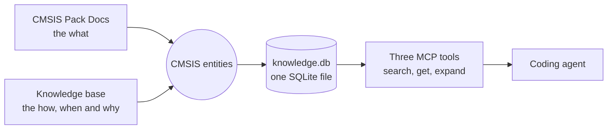

# Documentation

This folder explains the knowledge base. Read the pages in this order:

1. [concept.md](concept.md): why the knowledge base exists, what a unit is, how units relate to the CMSIS
   entities and to the Pack Docs, how an agent retrieves them, and which decisions are still open.
2. [implementation.md](implementation.md): the code as it is today. The data formats, the scripts with their
   inputs and outputs, the tables of `knowledge.db`, and how a search runs.

The root [README.md](../README.md) is the quick start. [HANDOVER.md](../HANDOVER.md) holds the decisions, the
known issues and the status.

## At a glance

Units are Markdown files in Git, written by people or converted from sources by scripts. The build checks
them, joins them to the entities, and writes one SQLite index. The agent receives summaries first and full text
on request.

## Folder contents

| Path | Content |
|---|---|
| `concept.md` | Concept and decisions, in English |
| `implementation.md` | Implementation reference, in English |

## Historical design notes

The former German design documents were removed from the current tree. Their source list also contains a
future-source backlog that the current `sources/` manifests do not cover. The last version is in Git history:
`git show f1bb74ff:docs/design/04_quellenliste.md`.
