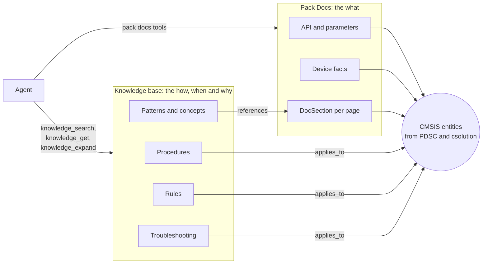
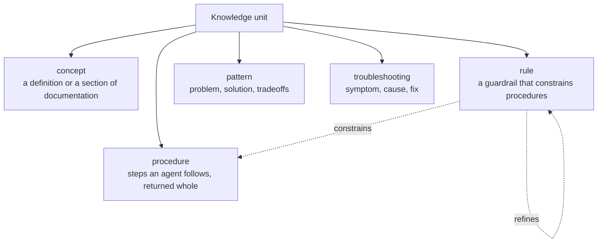
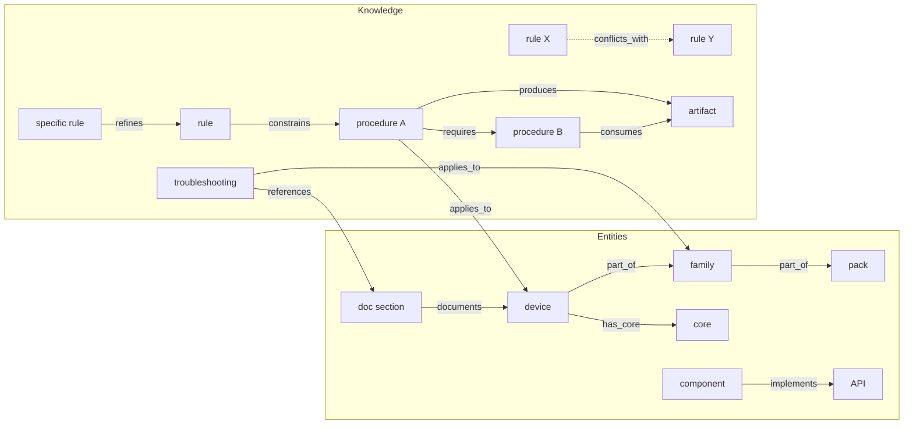
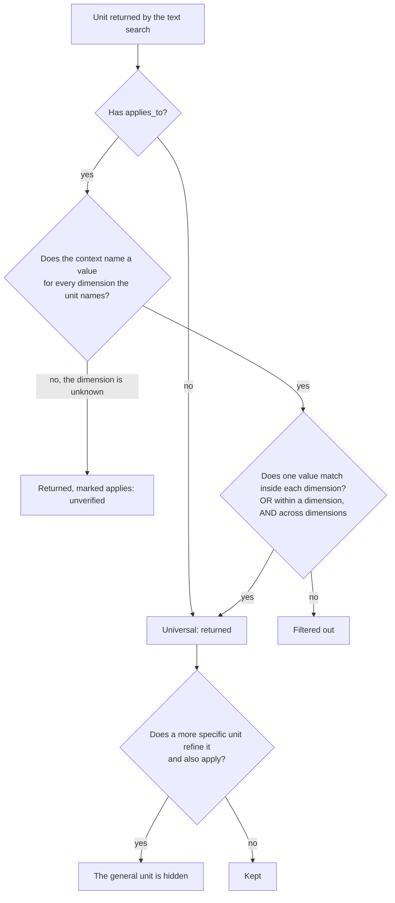
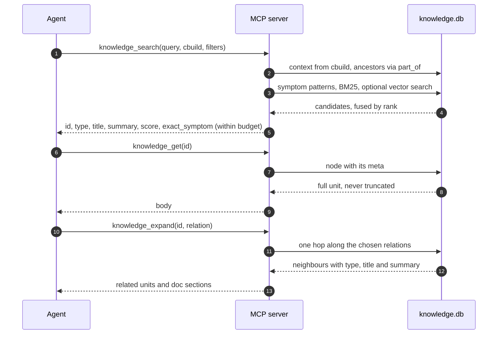
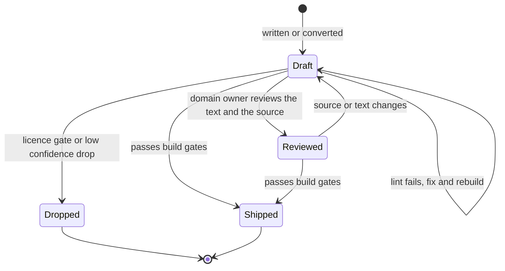

# Concept

The idea behind the knowledge base: what it is for, how its content is shaped, how it links to the CMSIS Pack
Docs, and how an agent reaches it. The [implementation reference](implementation.md) describes the code that
builds and serves it. This page describes why it is built that way.

## Why it exists

The CMSIS Developer Assistant (CDA) answers developers' questions with skills: long Markdown workflows that
an agent loads whole. Skills work, but they are expensive for small local models, they repeat the same
guardrails in every file, and their dependencies ("run this check first") live as prose.

The knowledge base adds the part that Pack Docs do not hold:

- **Pack Docs deliver the *what*.** API signatures, parameters, device facts, the content of a pack.
- **The knowledge base delivers the *how*, *when* and *why*.** Procedures, rules, troubleshooting by error
  message, patterns and domain knowledge (RTOS, linker, fault analysis, optimisation, testing).

Both meet at one join key: **CMSIS entities** (packs, devices, boards, cores, components, APIs, toolchains)
taken from the PDSC files and csolution notation. A knowledge unit says *which* entities it applies to, and
an entity knows its parent (a device belongs to a subfamily, a family, a pack).



## Two classes of node

The graph has two classes of node. The difference decides who writes them and how they are checked.

| Class | Examples | Written by | Checked by |
|---|---|---|---|
| **Entity** | pack, device, board, core, component, API, toolchain, tool, doc section | Generated from the pack index, every active PDSC and the workspace overlay. Never edited by hand | The generator |
| **Knowledge** | procedure, rule, concept, pattern, troubleshooting | Written and reviewed by people; some drafted by models and checked against their input | The lint, the licence gate and the review status |

Entities are the vocabulary; knowledge is what the agent reads. A new core that is missing from the pack index
is the one exception: it is maintained by hand in `kb-entities.yml` (see the [implementation reference](implementation.md#the-index-knowledgedb)).

### The five knowledge types

Every knowledge unit has exactly one type. The type decides the body layout and how the unit is returned.



| Type | Body holds | Extra fields | Special rule |
|---|---|---|---|
| concept | The definition or documentation section | none | Overview concepts get a lower rank (`role`) |
| procedure | Preconditions, steps, verification, stop conditions, output | `preconditions`, `verification`, `stop_conditions`, `output`, `triggers`, `unmapped` | Never truncated at retrieval |
| rule | The guardrail; for a specific rule, only the delta to the general one | `severity` (`must` or `should`), `rationale` | A specific rule `refines` a canonical rule |
| pattern | Problem, solution, tradeoffs | `problem`, `solution`, `tradeoffs` | none |
| troubleshooting | Cause, fix, evidence | `symptoms`, `symptom_regex`, `tool`, `code`, `severity`, `versions`, `resolution` | A line that matches `symptom_regex` pins the unit to the top |

`verification` lets the agent check its own result. `symptom_regex` matches an error message exactly, so the
right unit is found even when the wording of the query is different.

## Anatomy of a unit

A unit is one Markdown file: YAML frontmatter, then the body. The frontmatter below is illustrative, with the
field names the implementation uses today.

```yaml
id: opt-lto-armclang          # the node id and the file name
type: procedure
domain: optimization
title: Enable link-time optimisation with armclang
summary: Turn on LTO for an AC6 build and check that the image still links and boots.   # max. 40 words
status: draft                 # draft or reviewed; new units are always draft
applies_to:                   # empty means universal
  toolchain: [AC6]
  core: [Cortex-M55, Cortex-M85]
requires: [concept-link-time-opt]
source: "https://example.org/docs/lto.md"   # repo@commit:path, a URL, or file.pdf#page=N
license: Apache-2.0
mode: V                       # V verbatim, S own summary with a link, P private
```

The `status` and `license` values are checked by the build, not by convention. A unit without a licence cannot
enter the shipped index, and an `applies_to` that names an unknown entity fails the build in strict mode.

## Relations

Relations are edges of the graph. Entity-to-entity edges are generated. Knowledge-to-entity and
knowledge-to-knowledge edges come from the frontmatter, or from the skills the units were derived from.



| Edge | From → to | Source |
|---|---|---|
| `part_of` | device → subfamily → family → pack; component and API → pack | generated |
| `has_core`, `mounted_on`, `implements`, `documents` | device → core; board → device; component → API; doc section → entity | generated |
| `applies_to` | knowledge → entity, with an optional version range | frontmatter |
| `references` | knowledge → doc section | frontmatter |
| `requires` | knowledge → knowledge | frontmatter or derived from skill text; migrated links need review |
| `refines` | specific → general (rule or procedure) | frontmatter |
| `conflicts_with`, `supersedes` | rule or pattern ↔ rule or pattern; newer → older | frontmatter |
| `constrains` | rule → procedure | from skill guardrails |
| `produces`, `consumes` | procedure → artifact | from skills; a skill hands results over in files under `.agent-artifacts/` |

`produces` and `consumes` were added after reading the real skills: the bring-up and pack skills pass their
results between each other as files, and the graph needs to show that chain.

The stage-1 migration also created `requires` links from procedure mentions, including links that are not
prerequisites and one cycle. Until those links are reviewed, read a procedure's own preconditions and steps
before deciding which linked procedures to run. See the [known issues](../HANDOVER.md#known-issues).

## How a unit applies to a project

A knowledge search carries a project context (device, board, core, components, compiler) read from the
`cbuild` file of the project. A unit is then tested against that context.



Three consequences follow from these rules:

- **Inheritance.** A unit for a device family applies to every device under it, because the match walks
  `part_of` upwards. The context is extended by its ancestors (depth 6).
- **Strictness across dimensions.** A unit for Cortex-M55 with AC6 does not show up in a Cortex-M33 project
  that uses AC6. An earlier version used OR across all targets and showed it; the fix is recorded in
  [HANDOVER.md](../HANDOVER.md).
- **Unknown context is not a rejection.** A device from a local pack that the graph does not know still gets
  its core- and family-specific units, marked `applies: unverified`, and the answer reports the context as
  unresolved. Generic units are not pushed out by that.

## Retrieval through three MCP tools

The agent reaches the knowledge through three tools. Each step returns less text than the next one could.



### Example: creating a project for a board

A developer asks the agent to "create a new csolution project for the AppKit-E8 board, bring up the debugger and run to
`main`". It is one of the most common requests, and it has no `cbuild` file yet, because the project does not
exist. The agent starts with the question itself. In this run, the active window still supplied target context.

```mermaid
sequenceDiagram
    autonumber
    participant A as Agent
    participant S as MCP server
    participant K as knowledge.db
    A->>S: knowledge_search("create a new csolution project for the AppKit-E8 board, bring-up with debugger, run to main", k=8)
    S->>K: no new-project cbuild; active window supplies target context
    S->>K: BM25 over titles, summaries, triggers and bodies
    K-->>S: 7 of 47 matching units, none of them route-project or proc-start-cmsis-project
    S-->>A: ids, types, summaries (within budget)
    Note over A: The ranking misses the route. The agent retries with a narrower query or a types filter
    A->>S: knowledge_get("route-project")
    S->>K: node with body
    K-->>S: which procedure for which task, in order
    S-->>A: the route table
    A->>S: knowledge_get("proc-start-cmsis-project")
    S->>K: node with body
    K-->>S: full procedure, never truncated
    S-->>A: steps, verification, stop conditions
    A->>S: knowledge_expand("proc-start-cmsis-project", "requires")
    S->>K: one hop along requires
    K-->>S: proc-add-board-layer, proc-cmsis-bootstrap, proc-check-cmsis-environment, ...
    S-->>A: linked procedures with summaries
    Note over A: Read linked procedures and follow their own preconditions and steps
```

Trace of the calls. Values are shortened, and the scores are left out:

```txt
knowledge_search  -> 7 of 47 matching units, about 758 tokens. Context: STM32H723ZGTx (the window's active target,
                     not the AppKit-E8 named in the query). Top hits: g-sawcse-run-a-coroutine-task-... (procedure,
                     CPP_Architecture pack), tbx-csolution-project-structure-mlops-integration (concept),
                     zepb-ensemble-e8-ak-overview (concept, the AppKit-E8 device overview). Scores 0.015 to 0.017,
                     no exact symptom. route-project is not in the list.
knowledge_get     -> route-project (found by id, not by search): references proc-add-board-layer, proc-cmsis-bootstrap, ...
knowledge_get     -> proc-start-cmsis-project full procedure body
knowledge_expand  -> 7 relations of kind requires: proc-add-board-layer, proc-add-cmsis-target,
                     proc-check-cmsis-environment, proc-cmsis-bootstrap, proc-cmsis-debugger-setup,
                     proc-identify-cmsis-board-support
```

Two points make this flow useful:

- **The route is short, the procedures are complete.** When the search finds a route unit, it is a table of
  "task, procedure" pairs, and the procedure itself is returned whole. The agent does not have to load the
  whole skill set of the extension to find the right one.
- **The search is not reliable for this request.** The live run ranked the route outside its top seven, so the
  agent has to know the route's id or try a narrower query. The context also came from the active window, not
  from the board named in the query.
- **`requires` links need review.** The graph surfaces related procedures, but some migrated links are mere
  mentions and one cycle remains. Fetch a linked procedure when it is relevant, then follow its own
  preconditions and steps rather than running every linked procedure.

The principle behind it: **summaries first, full text on request**. A small local model can scan ten summaries
for the price of one skill. Procedures are the exception: once a procedure is chosen, it is returned in full,
because a shortened procedure is worse than no procedure.

## Storage

One SQLite file with an FTS5 table for text search, an optional `sqlite-vec` table for embeddings, and an edge
table. The concept deliberately avoids a graph database: the graph is small enough for SQL joins, and one file
is easy to ship. The tables are described in the [implementation reference](implementation.md#the-index-knowledgedb).

## Lifecycle of a unit



Every new unit starts as `draft`. Only a reviewer sets `reviewed`. The build ships both states, and the
confidence and origin fields let a build leave out the drafts that are not trusted yet.

## Delivery

The proposed delivery is a CMSIS Pack with a `knowledge/` folder, so that vendors could ship their own
knowledge next to their device packs and the CDA could index it when the pack is installed.

The current implementation ships the core index inside the extension. Local documentation and book packs carry
a prebuilt `.knowledge/knowledge.db`, which differs from the proposed folder. See the
[differences table](#differences-between-the-concept-and-the-implementation).

## Source rules

These rules apply to every unit, whatever the domain:

1. No invented facts. Each unit traces to a listed source or to a named author.
2. The licence mode decides what text may be stored: **V** full text under an open licence, **S** an own
   summary with a link, **R** reference only (linked, not converted). Units from CC BY-SA sources stay out of
   the shipped index until the legal review is done.
3. Numbers and findings are regenerated by the scripts, not copied by hand.
4. URLs and document numbers are checked before use. Sources that could not be checked automatically are
   marked.
5. New units are `draft`.

## Domains and priorities

The domains were ranked by how much an agent is missing without them.

| Priority | Domain | Content |
|---|---|---|
| 1, not in Pack Docs at all | RTOS kernel | scheduling, priority inversion, stack sizing, ISR rules, tickless mode, mapping CMSIS-RTOS2 to RTX, FreeRTOS, Zephyr, ThreadX |
| 1 | Error catalogue | messages from csolution, cbuild, linkers, compilers and pyOCD with cause and fix |
| 1 | Memory and linker | scatter files, linker scripts, map file analysis, stack and heap, MPU, TCM, cache |
| 1 | Fault analysis | HardFault decoding, CFSR, stack overflow, watchdog |
| 2, named by the team | Optimisation | flags per toolchain, LTO, code size, Helium, CMSIS-DSP and CMSIS-NN, low power |
| 2 | Testing | host versus target, Unity, FVP and AVH, hardware-in-the-loop, coverage, CI |
| 2 | Project management | layers, reference applications, pack versioning, reproducible builds, vcpkg |
| 3, supporting | Boot and update | start-up code, clock tree, bootloaders, MCUboot |
| 3 | Security | TrustZone-M, TF-M, PSA, secure boot, SBOM and the Cyber Resilience Act |
| 3 | Migration | uVision to csolution, AC5 to AC6, GCC against armclang |
| 3 | Trace and profiling | SWO, ETM, event recorder, PMU |
| 3 | Driver patterns | CMSIS-Driver, DMA, interrupt design, common bus pitfalls |
| 3 | Edge AI | Vela, operator support, arena size, quantisation |
| 3 | Coding standards | MISRA, functional safety, static analysis |
| 3 | Device errata | per vendor, shipped with the device pack |

The error catalogue was the proposed pilot domain: it is the easiest to fill from source and the easiest to
measure with a golden set of questions.

## Evaluation

Each domain gets a golden set of 50 to 100 real questions with the units that should answer them. The measures
are recall at k, mean reciprocal rank, and tokens per answer, compared with the skill-based baseline. The
evaluation is part of the build, so a change that lowers recall blocks it.

## Governance

Each domain should have one maintainer, with the owners listed in a `MAINTAINERS` file that the review tooling
reads. This is a concept only: the repository has no such file yet, and every unit is `draft` until a reviewer
sets it.

## Differences between the concept and the implementation

| Topic | Concept | Implementation today |
|---|---|---|
| Delivery | CMSIS Pack with a `knowledge/` folder | Core index in the extension's resources; local documentation and book packs use `.knowledge/knowledge.db` |
| Source field | `refs` | `source`, `doc_source` and `license` on every unit |
| Licence modes | V, S, R | V, S and P: P marks private units that are never published; R sources produce no unit |
| Embeddings | Part of the hybrid search | Optional. The shipped core index has none, and search falls back to BM25 |
| Stale detection | CI check of `applies_to` after a pack update | `build_index.py --strict`; the `unresolved` table lists the misses |
| Governance | One maintainer per domain, `MAINTAINERS` file | Not implemented |
| Source list | Per domain, with modes and licences | `sources/` records configured and reviewed sources; the broader candidate backlog remains in Git history |

## Status and open points

The knowledge base is a working prototype, and all of its units are `draft`. Current status, known issues and the
decisions still open are kept in [HANDOVER.md](../HANDOVER.md), which is newer than this page. The open points
that shape the concept were:

- Choose the pilot domain. The error catalogue was recommended.
- Approve the canonical rules that the skill migration proposed, and write their text by hand.
- Add an entity type for accelerators (NPUs such as Ethos-U), which the edge AI units need.
- Clear the legal position for Arm documents, the Keil knowledge base and the CC BY-SA learning paths before any
  of them is shipped.
- Agree the interface with the Pack Docs system of the CDA, so that both use the same document section ids.
