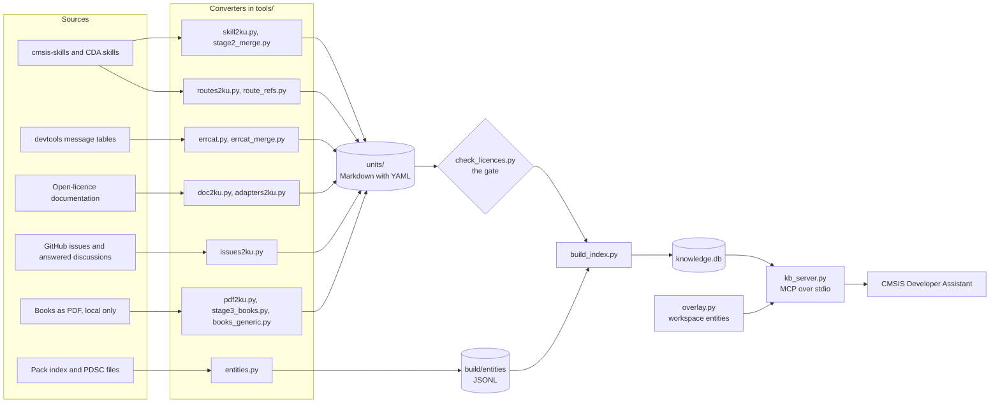
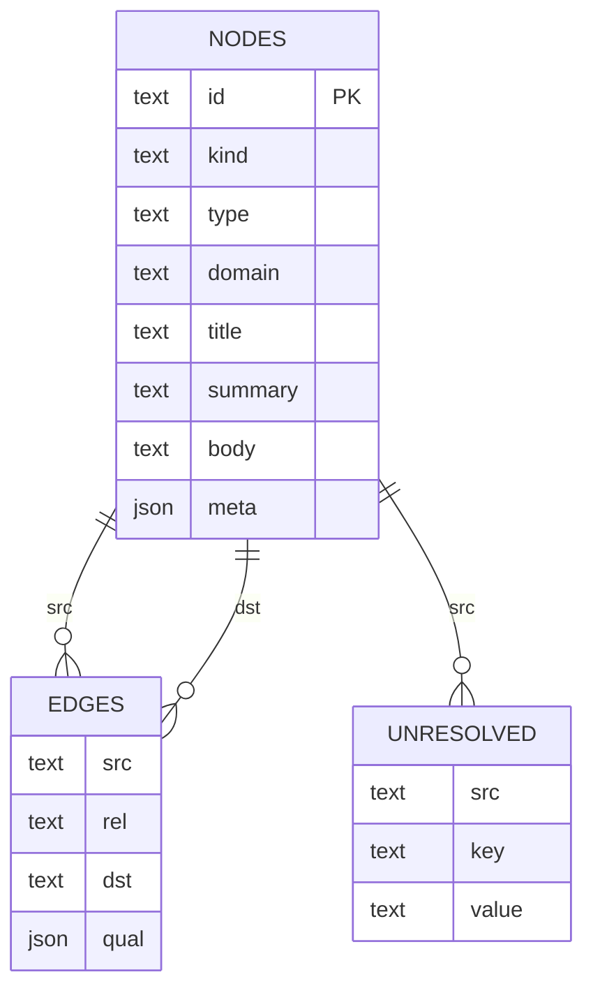
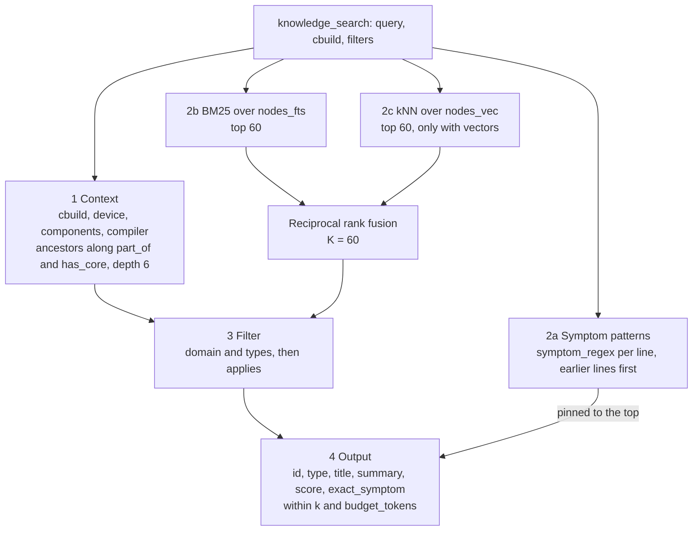

# Implementation reference: tools and data structures

The reference for everything in `tools/`, `scripts/` and `tests/`, and for the data they read and write: the
knowledge units, the entity graph, the index `knowledge.db`, the local packs and the exchange files of the
model-assisted stages. The [concept](concept.md) says why the knowledge base is built this way. The root
[README.md](../README.md) is the quick start, and [HANDOVER.md](../HANDOVER.md) holds the decisions and the
status. This page says what each piece is, what goes in and what comes out, so that a reader can change one
without reading all of them.

## The pipeline in one picture

The converters are deterministic, except where a model reads text: stage 2 of the skills, the error-catalogue
analysis, the issue digests and stage 3 of the books. Those steps exchange JSON through `stage2/`, and a script
checks every field before it enters a unit. The units are the source of truth and are committed; the index is
built from them and never edited.

The CDA receives the core index from the extension's resources (`resources/knowledge/core.db`) and the packs from
`<pack>/.knowledge/knowledge.db`.

## Data structures

### Knowledge unit

One Markdown file per unit: YAML frontmatter between `---` fences, then the body. `build_index.py` reads the
frontmatter with `yaml.safe_load` and keeps everything it does not map to a column in the `meta` JSON of the
node, so a converter may add fields without touching the index code.

Required by the lint: `id`, `type`, `title`, `status` (`draft` or `reviewed`); `summary` at most 40 words;
`type` one of the five knowledge types; every `applies_to` key known. The licence gate adds `license`.

| Field group | Fields | Meaning |
|---|---|---|
| Identity | `id`, `type`, `domain`, `title`, `summary`, `status` | `id` is the node id and the file stem. `summary` is what `knowledge_search` returns; the body only through `knowledge_get` |
| Type-specific | procedure: `preconditions`, `verification`, `stop_conditions`, `output`, `portability`, `triggers`, `unmapped`; rule: `severity` (`must`/`should`), `rationale`, `shared`, `delta_of`; pattern: `problem`, `solution`, `tradeoffs`; troubleshooting: `symptoms`, `symptom_regex`, `tool`, `code`, `severity`, `documented`, `resolution`, `versions` | `symptom_regex` is compiled at server start; a query line that matches it pins the unit to the top. The search tests each line of tool output alone, so a pattern matches one line and holds no line break; `tests/test_kb.py` checks that every pattern compiles and has none. `triggers` and the skill `description` are indexed in their own FTS column |
| Validity | `applies_to` | A map of dimension to list: `device`, `family`, `board`, `core`, `component`, `api`, `pack`, `toolchain` (`compiler` is an alias), `tool`. Values in csolution notation, a version range after `@` is kept as the edge's `qual`. Empty means universal |
| Relations | `requires`, `refines`, `constrains`, `produces`, `consumes`, `references`, `conflicts_with`, `supersedes` | Lists of unit or entity ids; each becomes an edge from this unit. A target that exists in no index named with `--known` is a build error, except `doc-`, `artifact-` and `asset-` ids, which come from a folder's `graph.json` |
| Provenance | `source` (`repo@commit:path`, a URL, or `file.pdf#page=N`), `doc_source` (the published page), `collection`, `license`, `mode` | `mode` is V (verbatim text under an open licence), S (own summary with a link) or P (private, never published). The gate accepts Apache-2.0, MIT, BSD-3-Clause and the marker `own summary of a GitHub issue` |
| Pipeline state | `stage2`, `extracted_from`, `derived_from`, `stage`, `cause_origin`, `confidence`, `evidence`, `doc_cause`, `checked`, `scope`, `role`, `book`, `chapter`, `page` | Where a model contributed and how sure it was. `--drop key=value` of the index build filters on these; `scope` (`coding`, `design`, `tool`, `project`, `other`) and `stage2/books-exclusions.json` keep tool and project knowledge out of a book pack; `role` (`intro`, `summary`, `preface`) scales an overview unit down in the ranking; on an error-catalog unit, `role: summary` marks a message that only sums up the errors printed before it, and the extension names the unit of the earlier error instead |

The five types and what their body holds: **concept** (a definition or a documentation section), **procedure**
(steps an agent follows, returned complete, never truncated), **rule** (a guardrail that constrains procedures;
a specific rule `refines` a canonical one and its body is the delta), **pattern** (problem, solution, tradeoffs),
**troubleshooting** (symptom, cause, fix; the error catalog and the issue digests).

Where the units live and where they come from:

| Folder | Produced by | Units in the core build |
|---|---|---|
| `units/skills/{procedure,rule,concept}`, `units/canonical`, `units/extracted/{concept,pattern,troubleshooting}` | `skill2ku.py` from cmsis-skills, then `stage2_merge.py` with `stage2/out_v2` | yes |
| `units/cda-skills`, `units/cda-routes` | `skill2ku.py` over the extension's `skills/` through its `catalog.json`, `stage2_merge.py` with `stage2/out_cda`, `routes2ku.py` | yes |
| `units/troubleshooting` | `errcat.py`, then `errcat_merge.py` with `stage2/errcat-out` | yes |
| `units/docs/<collection>` | `doc2ku.py` from `sources/docs.yml`; `units/docs/debug-adapters` from `adapters2ku.py` | yes |
| `units/issues/<repo>` | `issues2ku.py` from `stage2/issues-out` and `stage2/issues-qa` | yes, minus the low-confidence digests (`--drop`) |
| `units/docs-ccbysa/<collection>` | `doc2ku.py` from `sources/docs-ccbysa.yml` | no (share-alike, legal review pending) |
| `units/books/<book>`, `units/books-refined/<book>`, `units/books-generic/<book>` | `pdf2ku.py`, `stage3_books.py`, `books_generic.py` | never; git-ignored, local packs only |

A unit folder may carry a `graph.json` (`skill2ku.py` writes it): the nodes and edges of the skill
decomposition, including entity nodes of type `asset` (a file a skill ships, its content as body),
`artifact` (a file in `.agent-artifacts/` that procedures produce and consume) and `docsection` (a URL a skill
cites). `build_index.py` adds those entity nodes after the units, so `references`, `produces` and `consumes`
edges to them resolve.

### Entity graph

`build/entities/entities.jsonl` and `entity_edges.jsonl`, one JSON object per line, written by `entities.py`
from the Keil pack index and every active PDSC, and tracked in git. Entities are generated, never edited.
The ids follow csolution notation so that `applies_to` can use the same spelling:

| Type | Id | `meta` |
|---|---|---|
| `pack` | `pack:ARM::CMSIS` (no version) | `version`, `url`, `deprecated`, `replacement` |
| `family`, `subfamily` | `family:Keil::STM32U5 Series` | `vendor`, `pack` |
| `device` | `device:STM32U585AIIx` (`Dname` alone; vendor and processor name are stripped on resolution) | `vendor`, `pack`, the PDSC features `Dfpu`, `Dmpu`, `Dtz`, `Ddsp`, `Dclock`, … |
| `board` | `board:STMicroelectronics::B-U585I-IOT02A` | `vendor`, `pack`, revision |
| `core` | `core:Cortex-M33` | |
| `component` | `component:ARM::CMSIS:CORE` (`Cvendor::Cclass:Cgroup[:Csub]`; also found by `CMSIS:CORE`) | `pack` |
| `api` | `api:CMSIS:RTOS2` | `pack` |
| `toolchain` | `toolchain:AC6`, `GCC`, `CLANG`, `IAR` | `description` |
| `docsection` | `doc:<sha1-12>` of a PDSC `<book>`; `doc-<slug>` for a URL a skill cites | `path` (the URL), `pack` |
| `tool` | `tool:csolution`, `cbuild`, `cpackget`, `packchk`, `svdconv`, `pyocd`, `west`, `vcpkg`, `vela`, `gdb`, `cmsis-debugger`, `cmsis-solution` | built into `build_index.py`, not in the files |

Edges: `part_of` (device → subfamily → family → pack; component and api → pack), `mounted_on` (board →
device), `has_core` (device → core), `implements` (component → api), `documents` (docsection → entity),
`superseded_by` (pack → replacement). Each line is `{src, rel, dst, qual}`.

The overlay (`overlay.py`) produces the same two files for a developer's workspace: packs with `path:` in
csolution and cbuild files, every PDSC in the workspace, `$CMSIS_PACK_ROOT/.Local/local_repository.pidx`, and
`kb-entities.yml` (workspace root or `.cmsis/`) with `cores:` and `devices:` for parts that only have
documentation. Its nodes carry `meta.origin = "local"` and `meta.source`. The server loads it per
`knowledge_search` call with a `cbuild` argument, in memory; a vendor's CI can feed its output to
`build_index.py --entities` as a second folder.

### The index: `knowledge.db`

SQLite, schema version 1, built by `build_index.py`:

`nodes_fts` (FTS5) and `nodes_vec` (vec0) are virtual tables over `nodes`; `info` holds the build metadata.

| Table | Columns | Content |
|---|---|---|
| `nodes` | `id`, `kind` (`entity` or `knowledge`), `type`, `domain`, `title`, `summary`, `body`, `meta` JSON | Every entity and every unit. For a unit, `meta` is the frontmatter minus the five column fields, plus `path` (the file it came from). For an asset entity the body is the file |
| `edges` | `src`, `rel`, `dst`, `qual` JSON; primary key over all three | Entity edges, the unit relations, and `applies_to` resolved to entity ids (`qual` = `{"range": "…"}` when the value carried `@`). Index `edges_dst` on `(dst, rel)` |
| `unresolved` | `src`, `key`, `value` | `applies_to` targets no entity matched. `--strict` turns a non-empty table into exit code 2 (the stale check after a pack update) |
| `nodes_fts` | FTS5 over `title`, `summary`, `body`, `symptoms`, `triggers`; tokenizer `porter unicode61` | Knowledge units only; `triggers` also holds the skill description and the title split into words (`osThreadNew` → `os Thread New`). BM25 weights 8, 4, 1, 6, 6 |
| `nodes_vec` | `vec0(id, embedding FLOAT[384])` | Only without `--no-vec`: BAAI/bge-small-en-v1.5 through fastembed. The shipped core index has none |
| `info` | `key`, `value` | `schema_version`, `built_at`, `kb_commit`, `kb_dirty`, `recipe`, `units`, `nodes`, `edges`, `dropped`, `drop`, `license_<id>`, `embed_model`. The root README documents each key |

The core build of 21 Oct 2026 as an order of magnitude: 7 064 units (5 965 concept, 932 troubleshooting,
119 rule, 32 procedure, 16 pattern), 26 930 entities (12 618 devices, 6 390 components, 3 008 doc sections,
1 827 packs), 91 014 edges, of which 1 145 `applies_to`.

Resolution of `applies_to` (class `Resolver`): the key `compiler` becomes `toolchain`, a version range is
cut, a toolchain is upper-cased, a device loses `Vendor::` and `:Pname`, a component is also found by its
`Cclass:Cgroup` suffix, a family by its name without the vendor. The result is one edge per entity hit.

A **pack index** is the same schema with fewer rows. `build_split.sh`, `build_pack.sh` and `build_books.sh`
delete every entity the pack's units do not point at (cores, toolchains, tools and apis stay) and every edge
into the deleted nodes, except `references`, `requires` and `refines` edges whose target lives in another index
(`--known` made them legal at build time). The extension opens the core and every pack index as one set, so
a book unit may `refines` a core unit.

### Local packs

`packs/Local.<Name>/` holds a minimal PDSC (vendor `Local`, one release, `<license>LICENSE.txt</license>`),
`LICENSE.txt` and `.knowledge/knowledge.db`. The build scripts copy the three into
`$CMSIS_PACK_ROOT/Local/<Name>/<version>/`, which is where the CMSIS Developer Assistant looks for a pack's
knowledge. Three exist: `CMSIS_Knowledge` (the converted documentation, as a test of the split), `CPP_Books`
and `CPP_Architecture` (books; copyrighted, the index is git-ignored).

### Exchange files of the model-assisted stages

Everything under `stage2/` pairs a prompt with input and output folders. The prompts are the contract; the
merge scripts validate the answers.

| Stage | Prompt | Input → output | Merge |
|---|---|---|---|
| Skill decomposition (stage 2) | `decompose_prompt.md` | one JSON per procedure: `id`, `summary`, `triggers`, `applies_to`, `unmapped`, `verification`, `stop_conditions`, `rules` (generic, with or without delta), `extracted` (new units) → `out_v2/`, `out_cda/` | `stage2_merge.py`: frontmatter of the procedure, canonical rule stubs in `units/canonical`, extracted units in `units/extracted` |
| Error-catalog causes | read from the devtools source | `errcat-out/*.json`: `{id, cause, fix, evidence[], confidence, note}` | `errcat_merge.py`: Cause, Fix, Note, Evidence sections; `cause_origin: source-analysis` |
| Issue digests | `issues_prompt.md`, `issues_qa_prompt.md` | `issues-out/*.json`: `{issue, tool, title, symptoms[], cause, fix, applies_to, versions, resolution, confidence}`; `issues-qa/` the faithfulness check | `issues2ku.py`: one unit per issue, `checked` = supported, corrected or unsupported (dropped) |
| Books, stage 3 | `books_prompt.md` | batch files per book (`prepare`), answers from reader agents or the Message Batches API (`submit`, `fetch`) | `stage3_books.py merge`: every field checked against the input before it enters `units/books-refined` |
| Books, generic knowledge | `books_generic_prompt.md`, `books_conflict_prompt.md`, `books_scope_prompt.md`, `books_request_conflict_prompt.md` | pieces with a verbatim `evidence` quote; conflict checks against the five nearest core units; scope classification | `books_generic.py`: `units/books-generic`, `stage2/books-exclusions.json` (ids by scope), review folders |

### Running the model-assisted stages unattended

`tools/model_run.py <stage>` asks the same questions of the same prompts through the Claude API, one
request per item, with the answer constrained to the JSON the merge script reads (structured outputs,
`claude-haiku-5-5`). Next to every output folder a manifest, `<out>.manifest.json`, records the hash of
each item's input: an item is sent again only when its input changed, or with `--force`. The answers of
the first runs, written by reader agents, were adopted into the manifests (`--adopt`, `--adopt-all`) and
are never sent again unless forced. `--dry-run` lists what is due; `--limit` caps a run; `--batch` goes
through the Message Batches API instead of parallel requests.

| Stage | Items and their hash | Request | Output |
|---|---|---|---|
| `decompose` | one per procedure of a stage-1 folder: the body and the rules that constrain it | the procedure file, its rule files, the entity ids (api, core, toolchain, the Arm and Keil components, the tools) | `<out>/proc-<id>.json` for `stage2_merge.py` |
| `errcat` | one per unit of `units/troubleshooting`: message, trigger code, README text; the source lines are sent but not hashed | the message with sixty lines around each place that prints it, from the devtools clone (`--devtools`) | `<out>/auto-<date>.json` for `errcat_merge.py`; `stage2/errcat_prompt.md` |
| `issues` | one per thread in `--threads`: title, state, body (4,000 characters), the first eight comments (1,500 each), as the readers' batches were cut | the thread | `<out>/auto-<date>.json` for `issues2ku.py`; a thread the model skips is recorded as not kept and its older digest removed |
| `issues-qa` | one per digest that has a thread in `--threads` | digest and thread | `<out>/auto-<date>.json`, the check `issues2ku.py` applies |

`tools/fetch_issues.py <out> [--since] [--manifest]` fetches the threads through the GraphQL API with
`GH_TOKEN`: closed issues (`COMPLETED`, at least one comment, closed since the date), open issues with a
comment updated since the date, and pyOCD's answered Q&A discussions; `--manifest` takes the date from the
issues manifest, which the runner advances to the newest thread of a complete run. The raw threads stay
in the work folder, as before.

`scripts/rebuild.sh` runs the stages when `ANTHROPIC_API_KEY` is set (`MODEL_LIMIT`, `MODEL_ARGS`), the
issue fetch when a GitHub token is set as well. The workflows under `.github/workflows/`: `ci.yml` builds
the core index from the committed units on every push and pull request and gates it (licence gate,
`test_kb.py`, the golden set at hit@5 0.85 and MRR 0.65); `rebuild.yml` (by hand, or monthly) runs the
rebuild with the model stages from the `ANTHROPIC_KEY` secret, builds and gates the core index, and opens a
pull request whose body lists what each stage sent and cost; `release.yml` runs `scripts/release_core.sh`
for a version. A pull request opened by the workflow does not trigger `ci.yml` (a GitHub rule for the
workflow token); the same gates ran inside the rebuild job.

### Sources list

`sources/docs.yml` (open licences) and `sources/docs-ccbysa.yml` (CC BY-SA) list one entry per documentation
repository: `name`, `prefix` (the id prefix of its units), `repo`, `include`/`exclude` globs, `format` (`md`,
`doxmd`, `doxtxt`, `hugo`), `license`, `domain` and per-path `domains` overrides, `url` with `{stem}`,
`{page}`, `{dir}` and `{name}` placeholders for the published page, `sparse` paths for large clones.
`sources/sources-review.csv` records the review decision per collection, with a `tier` column that
`build_split.sh` reads (`pack` = goes into the documentation pack).
The former per-domain source list also included candidates not represented in these manifests. Its last
version is archived at `f1bb74ff:docs/design/04_quellenliste.md`.

### Test data

`tests/golden.json` holds questions and tool outputs with the unit ids that answer them.
`golden-books.json` and `golden-architecture.json` cover the book packs; `agent-requests.json` holds generic
requests an agent makes in a CMSIS session, without expected units, for the conflict measurement.
`tests/fixtures/units` is a small unit set for `test_kb.py`; `tests/fixtures/workspace` a workspace with a
local DFP and a `kb-entities.yml`.

## Tools

Each tool is a Python script with its contract in the module docstring; `python tools/<name>.py` without
arguments prints it. All of them run from the repository root in the `.venv`.

### Fetching and entities

| Tool | In → out |
|---|---|
| `scripts/fetch_sources.py <work>` | Keil `index.pidx` and every active PDSC (through the keil.com mirror, vendor URL as fallback), shallow clones of cmsis-skills and devtools → `<work>/` |
| `tools/entities.py <index.pidx> <pdsc-dir> <out>` | → `entities.jsonl`, `entity_edges.jsonl` |
| `tools/overlay.py <workspace> <out>` | The workspace's local packs, PDSCs, local repository index and `kb-entities.yml` → the same two files, `meta.origin = local`. Also used in memory by the server |

### Converters

| Tool | In → out |
|---|---|
| `tools/skill2ku.py <skills-dir> <out> [--known <units>…]` | cmsis-skills, or the extension's `skills/` through `catalog.json` → procedure, rule, concept units, `graph.json` with asset, artifact and docsection entities; guardrails deduplicated across skills; a reference to a `--known` procedure becomes a `requires` edge |
| `tools/stage2_merge.py <units> <json-dir>` | Stage 2 JSON → frontmatter, canonical rules, extracted units |
| `tools/routes2ku.py <skills.config.json> <out> <units>…` | The extension's skill categories → one `route-<domain>` concept per domain: which procedure for which task, in which order |
| `tools/route_refs.py --targets <units>… <folder>…` | Rewrites `$skill-name` hand-overs into links to the procedure units, since the extension installs no other skill |
| `tools/errcat.py <devtools> <out>` | Message tables of packchk, svdconv, the csolution logger calls, its toolchain messages (`m_toolchainErrors`) and the schema checker's message → one troubleshooting unit per message with `symptom_regex` for the message's first line, in which a variable at the end and a part printed only on a condition (`cond ? "text" : ""`) may be empty; `role: summary` for the messages in its `SUMMARY` list |
| `tools/errcat_merge.py <units/troubleshooting> <stage2/errcat-out> [repo@commit]` | The source analysis → cause, fix, evidence, confidence |
| `tools/doc2ku.py <sources.yml> <docs-dir> <out> [--only=…] [--fetch]` | Documentation repositories (Markdown, doxygen Markdown, doxygen comment files, reStructuredText, Hugo) → one concept per H2 section, split at H3 when long, HTML tables as Markdown |
| `tools/adapters2ku.py <debug-adapter-registry> <out>` | `registry/debug-adapters.yml` → one concept per debug adapter (aliases, launch template, defaults) |
| `tools/issues2ku.py <stage2/issues-out> <units/issues> [<batches>]` | Issue digests, filtered by the threads the readers were given and corrected by the QA pass → troubleshooting units, mode S |
| `tools/pdf2ku.py <out> <book.pdf>… [--domain] [--publisher]` | PDF outline (`pdftohtml -xml`) and text (`pdftotext`) → one concept per section of each chapter; front and back matter skipped |
| `tools/stage3_books.py prepare\|submit\|fetch\|merge …` | Script clean-up, then a model pass per unit (type, summary, triggers, Markdown body, extracts, `applies_to`), every answer checked before the merge |
| `tools/books_generic.py extract-prepare\|extract-merge\|check-prepare\|check-merge\|classify-prepare\|classify-merge\|request-merge …` | Generic knowledge in own words with an evidence quote, checked against the core for duplicates and contradictions, classified by scope, and judged on real agent requests |
| `tools/model_run.py <decompose\|errcat\|issues\|issues-qa> --out … [--units\|--threads\|--digests] [--dry-run\|--adopt\|--force\|--limit\|--batch]` | The model-assisted stages through the API, only the items whose input changed; manifests next to the output folders (see below) |
| `tools/fetch_issues.py <out> [--since] [--manifest]` | The issue threads since a date, GraphQL, in the readers' batch shape |
| `tools/review_csv.py <units/troubleshooting \| units/issues> <out.csv>` | The draft units a person still has to review, least certain first, with empty reviewer and comment columns (`messages-to-review.csv`, `issues-to-review.csv`) |

### Gate, build and serving

| Tool | In → out |
|---|---|
| `tools/check_licences.py <units>…` | Exit 1 with the files when a unit has no `license`, a licence outside the four allowed, or `mode: P`; an empty folder fails too |
| `tools/sources_md.py --units <dir>… [--out build/SOURCES.md] [--fetch]` | Attribution for the index's sources; `--fetch` records licence and NOTICE data in `sources/licenses.yml` |
| `tools/build_index.py --units <dir>… --entities <dir>… --out <db> [--strict] [--no-vec] [--recipe <name>] [--drop k=v,…] [--exclude <ids.json>] [--known <db>]` | Lint, resolve, FTS, optional vectors, edges, `info` → `knowledge.db`. `--drop` leaves out units whose frontmatter matches all pairs (repeat for alternatives); `--exclude` by id; `--known` makes another index's ids legal edge targets; `--strict` fails on unresolved `applies_to` |
| `tools/kb_lib.py` | The retrieval library: `KB(path, use_vec)`, `parse_cbuild`, `context_entities`, `search`, `get`, `expand`, `use_workspace`. Used by the server, the tests and the evaluation scripts |
| `tools/kb_server.py <knowledge.db>` | MCP server on stdio with `knowledge_search`, `knowledge_get`, `knowledge_expand`; `KB_NO_VEC=1` for keyword search only |

### Scripts

| Script | What it builds |
|---|---|
| `scripts/setup.sh` | `.venv` with `requirements.txt` (PyYAML, sqlite-vec, fastembed, mcp); `requirements-build.txt` is PyYAML alone, enough for the core build |
| `scripts/rebuild.sh [work]` | The full pipeline from live sources: fetch, entities, skills with stage 2, error catalog, documentation, adapters, issues, routes, index, tests. `NO_VEC=1`, `CCBYSA=1`, `CDA=<checkout>`; with `ANTHROPIC_API_KEY` the model stages through `model_run.py` (`MODEL_LIMIT`, `MODEL_ARGS`), with a GitHub token the new issue threads |
| `scripts/build_core.sh [out]` | The index the extension ships: licence gate over the eight core folders, `--no-vec --recipe core --drop confidence=low,cause_origin=issue-digest`, `test_kb.py`, then the `info` table and the SHA-256 |
| `scripts/build_split.sh` | The core without documentation, plus `packs/Local.CMSIS_Knowledge` with the documentation collections of tier `pack` |
| `scripts/build_books.sh [books-dir]` | All books of a folder into `packs/Local.CPP_Books`; `CONVERT=0`, `REFINED=0`, `INSTALL=0` |
| `scripts/build_pack.sh <Name> <collection>…` | One pack from named book collections, refined and generic units preferred, exclusions applied, installed into the pack root |
| `scripts/release_core.sh <version>` | Builds the core at a clean, pushed HEAD and publishes the index, its hash, metadata and `SOURCES.md` as a GitHub release |

### Tests and evaluation

| Script | What it measures |
|---|---|
| `tests/test_kb.py` | Checks on a fixture build: strict mode and stale detection, inheritance along `part_of`, `refines`, AND across dimensions, unverified and unknown contexts, the overlay, version ranges, exact symptom hits (also with a tool-output prefix and two lines), the token budget, and the MCP round trip. `KB_INDEX=<db>` runs the retrieval checks against a built index |
| `tests/eval_search.py [db] [--k] [--golden]` | hit@1, hit@5 and MRR of the golden set through `kb_lib`, with and without vectors |
| `tests/eval_search.js <db> <CDA checkout>` | The same golden set through the extension's own search code |
| `tests/eval_conflicts.py --candidate=<pack db> [--core] [--docs] [--k] [--out] [--gate]` | Shadowing (does a pack unit outrank the expected core unit) and exposure (which pack units reach the top k for the generic requests); writes the judge batches for `books_generic.py request-merge` |

## How a search runs

`knowledge_search` in `kb_lib.search`, in order:

1. **Context.** A `cbuild` path is parsed for device, board, compiler and components; `device`, `components`,
   `compiler` and `tools` arguments add to it. Each becomes an entity id, extended by its ancestors along
   `part_of` and `has_core` (depth 6), so a device brings its family, pack and core. Ids the graph does not know
   are reported as `context_unresolved`; the overlay is loaded first for a workspace.
2. **Candidates.** The query is split into lines and stripped of `error tool:` prefixes. Every `symptom_regex`
   is tried per line; a hit is pinned above everything, earlier lines first (in tool output the first error is
   the cause). Then BM25 over `nodes_fts` and, with vectors, kNN over `nodes_vec`, 60 each, fused by reciprocal
   rank fusion. Overview units (`role`) are scaled down.
3. **Filter.** `domain` and `types` when given. Then `applies`: a unit without `applies_to` is universal;
   otherwise every dimension it names must have one target in the context (AND across dimensions, OR within
   one). A dimension the context says nothing about does not reject the unit but marks it `applies: unverified`.
   A unit that `refines` another hides the general one when both pass.
4. **Output.** `id`, `type`, `title`, `summary`, `score`, `exact_symptom` per result, up to `k` and within
   `budget_tokens`. `knowledge_get` returns the node with its `meta`, never truncated; `knowledge_expand`
   the neighbours over one relation or all, with direction, type, title and summary.
