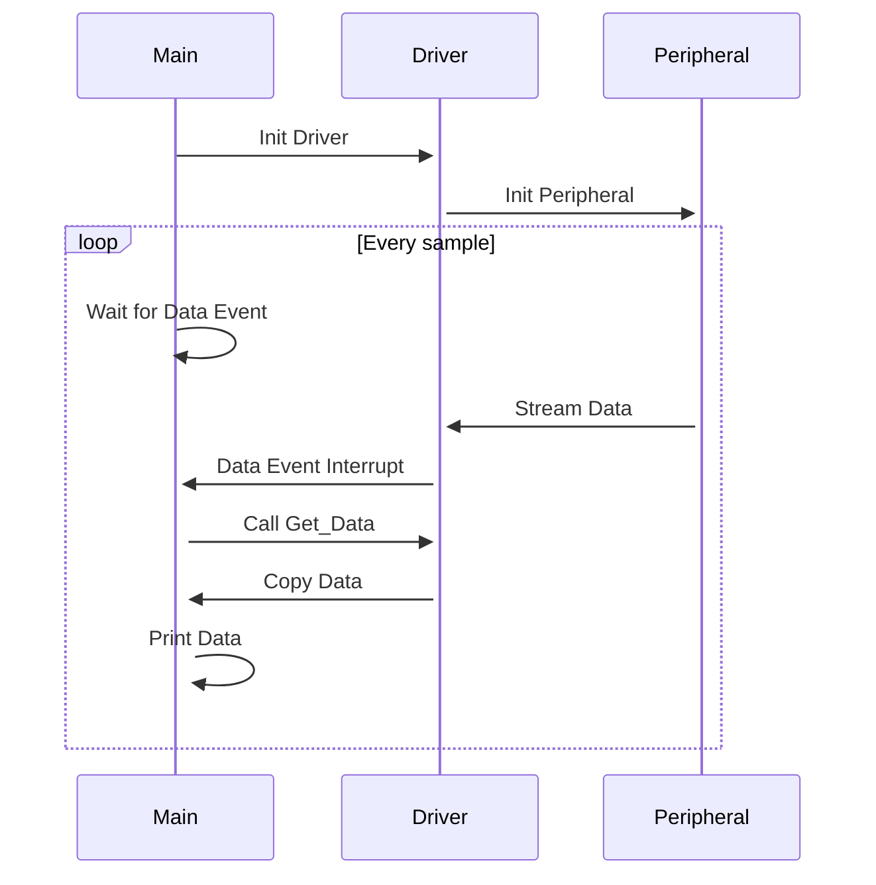
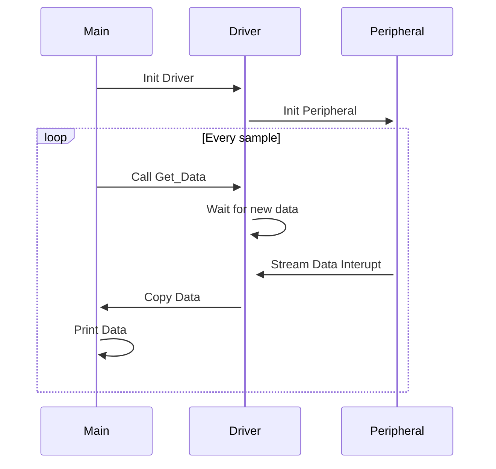

The sections below explain the application flows for the supported build types.

### Event Driven Flow

Sensor data is continuously streamed from the sensor. When DMA block is filled with data a sensor event is triggered, the block is copied and application prints obtained values into the console.

Use `.event` as the build type, followed by the target platform.

### Gated fetch Flow

Sensor data is fetched only when requested so by the application. The peripheral will be paused between each data fetch.

Use `.gated` as the build type, followed by the target platform.

