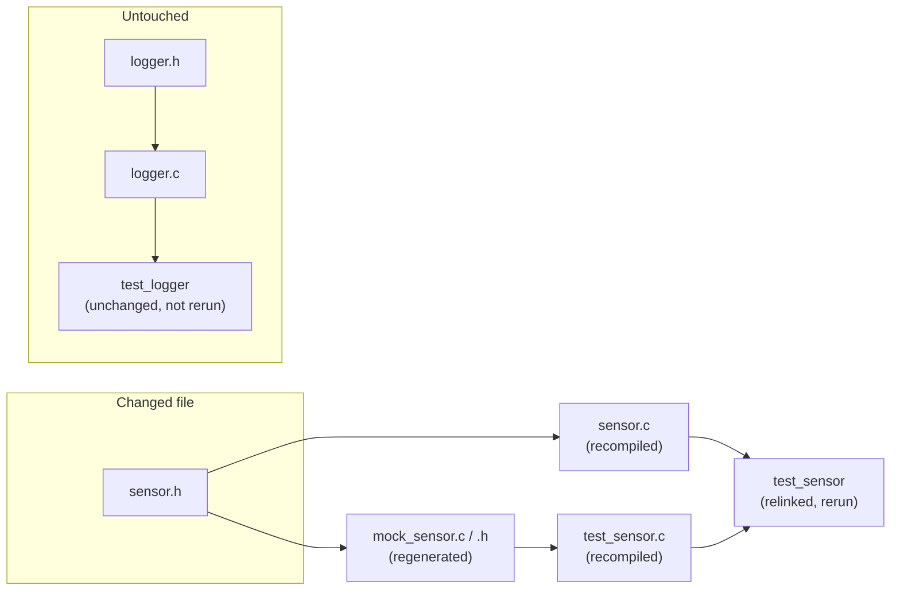
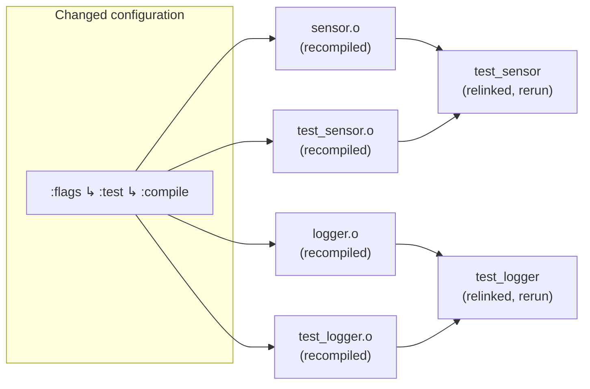

Say a project has a `sensor` module (`sensor.c` / `sensor.h`) and a `logger`
module (`logger.c` / `logger.h`), each with its own test file. `test_sensor.c`
mocks `sensor.h` while `test_logger.c` has nothing to do with `sensor.h` at all.

### Header file change

You add a new function prototype to `sensor.h`. On the next build, Ceedling
walks its dependency graph and finds every target that lists `sensor.h` as an
antecedent:

- `mock_sensor.c` / `mock_sensor.h` — regenerated, since the mock is derived
  from `sensor.h`’s contents.
- `sensor.c` — recompiled, since it includes `sensor.h` directly.
- `test_sensor.c` — recompiled, since it also includes `sensor.h`
  (via the mock).
- `test_sensor` executable — relinked and rerun, since its objects changed.

`logger.c` and `test_logger.c` never reference `sensor.h`. Nothing about them
changed. Ceedling leaves that whole chain untouched and doesn’t rebuild or
rerun `test_logger` but will report its cached test results.

### Configuration change

Now say you add a a new warning flag under `:flags ↳ :test ↳ :compile` in 
your Ceedling project configuration. No source file changed at all.

A compile flag is part of a compiled object’s configuration and is tracked
as metadata rather than as a file antecedent. Changing this flag invalidates 
every object built with that flag set, project-wide, regardless of whether the
object’s own source changed.

- Every test source’s object file — `test_sensor.o`, `test_logger.o`, and any
  others — is recompiled with the new flag.
- Every module source’s object file compiled into a test build is likewise
  recompiled.
- Both test executables are relinked and rerun, since their objects changed.

