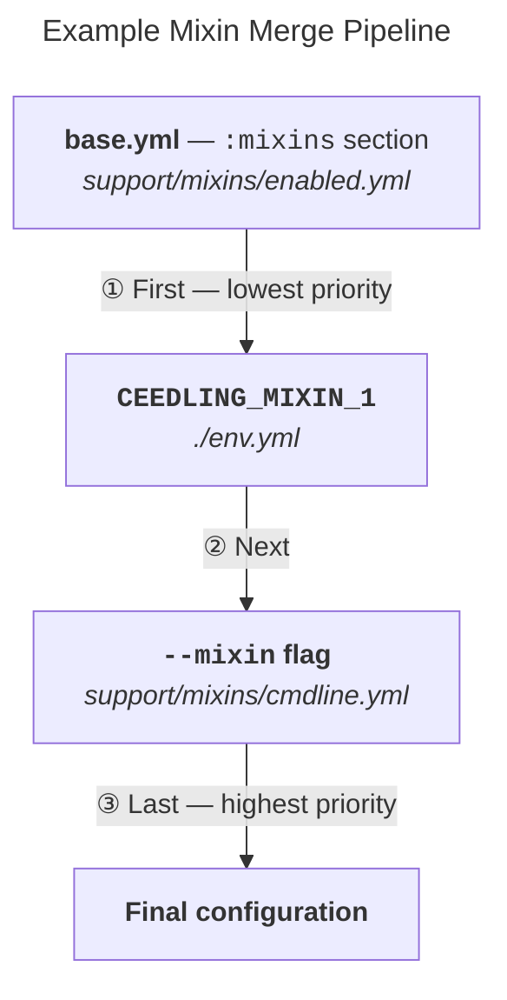

### Our Example Scenario
Let’s start with an example that helps explain how mixins are merged.
Then, the documentation sections that follow will discuss everything
in detail.

In this example, we will load a base project configuration and then
apply three mixin files using each of the available means:

1. `:mixins` section in the base project configuration file
1. Envionment variable `CEEDLING_MIXIN_1`
1. Command line `--mixin` flag



### Example environment variable

`CEEDLING_MIXIN_1` = `./env.yml`

### Example command line

An environment variable as the preceding inserts a mixin outside of the 
command line shown below. The _base.yml_ file is merged with the mixin file 
_enabled.yml_ (all documented below).

`ceedling --project=base.yml --mixin=support/mixins/cmdline.yml <tasks>`

!!! tip
    The `--mixin` flag supports more than filepaths, and the 
    [`--mixin` flag](#-mixin-command-line-flags) can be used multiple times 
    in the same command line to smoosh together multiple mixins.

The example command line above with the precending environment variable 
will produce the following logging output if verbosity is set above NORMAL:

```
🚧 Loaded project configuration from command line argument using base.yml
 + Merging project configuration mixin using ./enabled.yml
 + Merging CEEDLING_MIXIN_1 mixin using ./env.yml
 + Merging command line mixin using support/mixins/cmdline.yml
```

_Notes:_

* The logging output above referencing _enabled.yml_ comes from the 
  `:mixins` section within the base project configuration file (_base.yml_)
  provided below.
* The resulting configuration in this annotated example is missing settings 
  required by Ceedling. If these examples were to be used in their stripped 
  down form, they would cause a validation build error.

### Example Configuration files

#### _base.yml_ — Our base project configuration file

Our base project configuration file:

1. Sets up a configuration file-based mixin. Ceedling will look for a mixin
   named _enabled_ in the specified load paths. In this simple configuration
   that means Ceedling looks for and merges _support/mixins/enabled.yml_.
1. Creates a `:project` section in our configuration.
1. Creates a `:plugins` section in our configuration and enables the standard 
   console test report output plugin.

```yaml
:mixins:              # `:mixins` section only recognized in base project configuration
  :enabled:           # `:enabled` list supports names and filepaths
    - enabled         # Ceedling looks for name as enabled.yml in load paths and merges if found
  :load_paths:
    - support/mixins

:project:
  :build_root: build/

:plugins:
  :enabled:
    - report_tests_pretty_stdout
```

#### _support/mixins/cmdline.yml_ — Mixin via command line filepath flag

This mixin will merge a `:project` section with the existing `:project`
section from the base project file per the deep merge rules above.

```yaml
:project:
  :use_test_preprocessor: :all
  :test_file_prefix: Test
```

#### _env.yml_ — Mixin via environment variable filepath

This mixin will merge a `:plugins` section with the existing `:plugins`
section from the base project file per the deep merge rules (noted 
after the examples).

```yaml
:plugins:
  :enabled:
    - compile_commands_json_db
```

#### _support/mixins/enabled.yml_ — Mixin via base project configuration file `:mixins` section

This mixin listed in the base configuration project file will merge
`:project` and `:plugins` sections with those that already exist from
the base configuration plus earlier mixin merges per the deep merge 
rules (noted after the examples).

```yaml
:project:
  :use_test_preprocessor: :none

:plugins:
  :enabled:
    - gcov
```

### Example resulting configuration

Behold the project configuration following mixin merges:

```yaml
:project:
  :build_root: build/           # From base.yml
  :use_test_preprocessor: :all  # Value in support/mixins/cmdline.yml overwrote value from support/mixins/enabled.yml (cmdline merged last)
  :test_file_prefix: Test       # Added to :project from support/mixins/cmdline.yml

:plugins:
  :enabled:                       # :plugins ↳ :enabled from two mixins merged with original list in base.yml
    - compile_commands_json_db    # From env.yml (prepended before base.yml entry — env.yml is higher priority)
    - gcov                        # From support/mixins/enabled.yml (prepended before base.yml entry)
    - report_tests_pretty_stdout  # From base.yml
```
!!! note
    Original `:mixins` section is removed from resulting config
