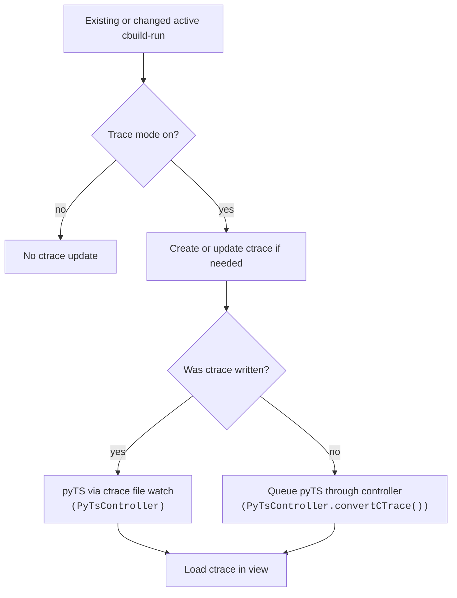

At startup, after an active-solution or cbuild-index change, and when the
watched cbuild-run is created or changed, `TraceConfigurationFileWatcher`
forwards the active cbuild-run event. `TraceConfigurationGeneratedCTraceFileManager`
writes the matching ctrace file only when it is new or needs processor setup
entries.

For an unchanged existing ctrace file, every forwarded cbuild-run event queues
an explicit conversion, even when the production ctrace-run file already
exists. The cbuild-run input may have changed while the ctrace input stayed the
same, making the existing output stale. Equivalent requests that overlap are
coalesced by `PyTsController`; sequential events after a conversion completes
remain distinct. A ctrace write can still start pyTS through the separate
`PyTsController` watcher below.
