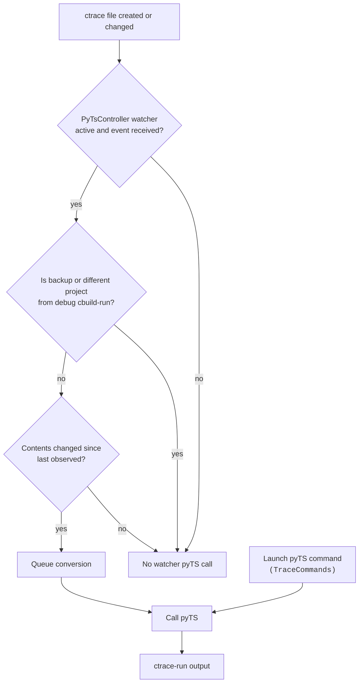

The "Generate default ctrace" command (`TraceConfigurationCommands`), an
external edit, and a webview Save (`TraceConfigurationModel`) can all write
the production ctrace file. They do not call pyTS directly.

`TraceConfigurationGeneratedCTraceFileManager` may also write that file when
it processes a created or changed cbuild-run, including an existing one selected
after the active solution changes.

The ctrace create/change event starts pyTS only if `PyTsController` is already
watching and receives it.

The watcher observes `.cmsis/[!~]*.ctrace.{yml,yaml}` while the
trace-generation view setting is enabled. It matches ctrace names to the
debug session's cbuild-run filename and locates `.cmsis` under the active
solution folder when available. Without a `.cbuild-run.yml` session path, it
skips the project check.

`TraceConfigurationFileWatcher.watchCurrentFile()` reloads YAML only;
it is installed after a generated file is loaded and pauses during unsaved
webview edits.
