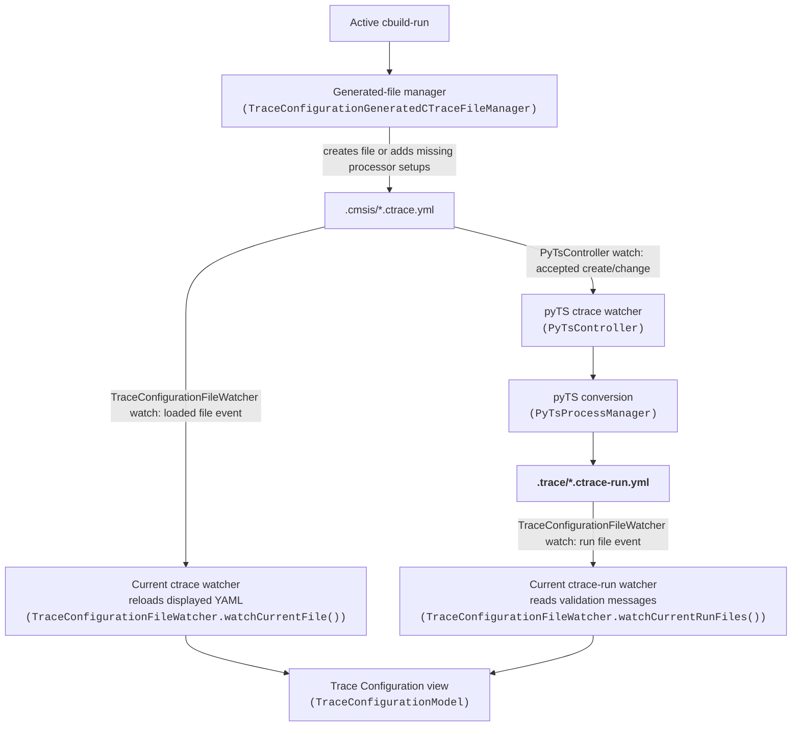

The two ***ctrace*** watchers have different jobs.

- `PyTsController` starts pyTS conversion.
- `TraceConfigurationFileWatcher.watchCurrentFile()` reloads the displayed YAML.

The same `TraceConfigurationFileWatcher` class also watches the current
**ctrace-run** files. Each class named on a file-event edge registers its watch
through `FileWatchManager.addWatch()`.

The **loaded file** is the exact ctrace file currently open in the Trace
Configuration view. Its watcher receives create, change, and delete events for
that path; it reloads the displayed YAML only when the file's timestamp or
size differs from the last loaded version. The watcher is paused during
unsaved webview edits.

An **accepted create/change event** means the separate `PyTsController`
watcher is active, receives an event for a non-backup ctrace file matching
`.cmsis/[!~]*.ctrace.{yml,yaml}`, accepts it for the current debug context,
and finds that its contents differ from the last observed contents. That
watcher then queues pyTS conversion. It does not process delete events.
