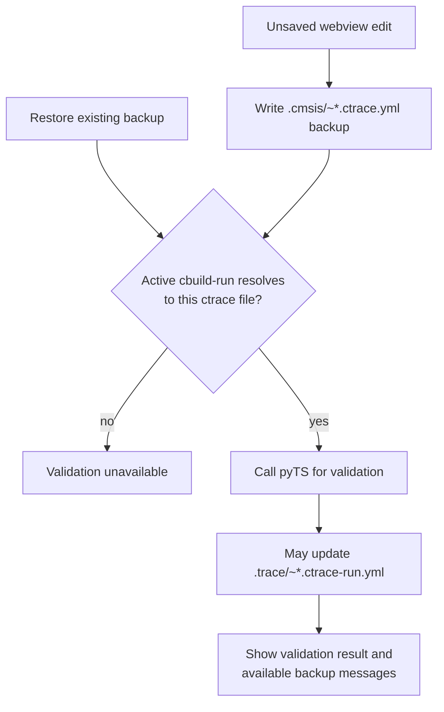

An edit remains in memory while `DebouncedTraceConfigurationBackup` writes a
backup beside the production ctrace file. Restoring an existing backup follows
the same validation path. `PyTsTraceConfigurationPrevalidator` checks that the
file is the active pyTS input before calling pyTS.

### ctrace-run observation

`TraceConfigurationFileWatcher.watchCurrentRunFiles()` watches both ctrace-run
filenames for the current ctrace file. `TraceConfigurationModel` reads
validation messages on create/change and clears them on delete. It uses
production messages when clean and backup messages while an unsaved edit is
active. Loading a clean ctrace file also reads an existing production
ctrace-run file without waiting for a watcher event.
