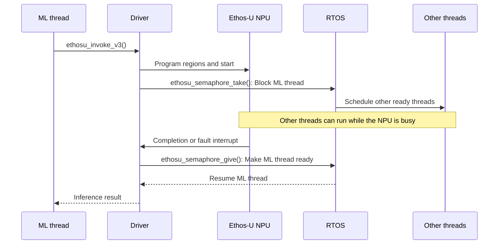
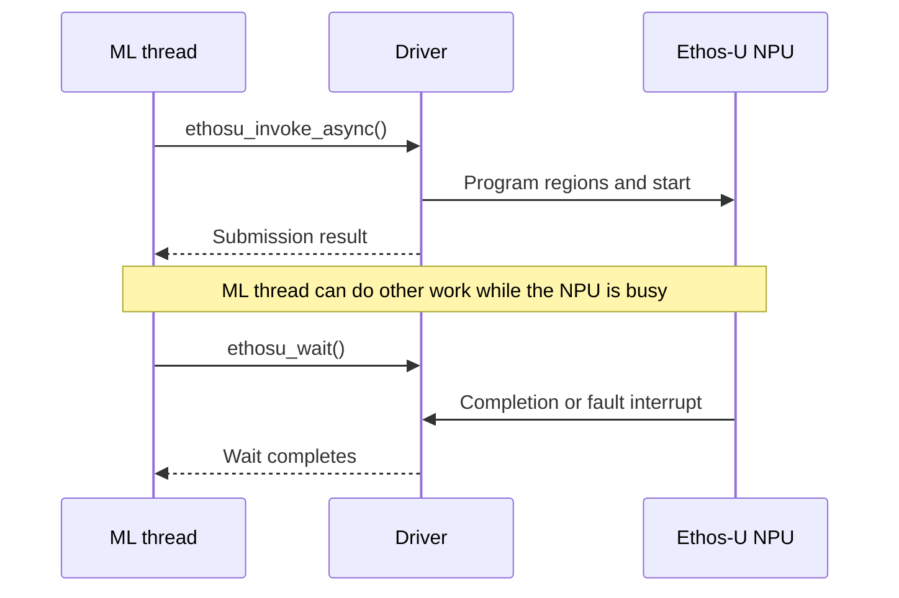

Inferences can be invoked in two manners:
synchronously or asynchronously. The two types of invocation can be freely mixed
in a single application.

### Synchronous invocation

The typical usage of the driver is the synchronous invocation as shown below:

```c
// reserve a driver to be used (this call could block until a driver is available)
struct ethosu_driver *drv = ethosu_reserve_driver();
// ...
// run one or more inferences
int result = ethosu_invoke_v3(drv,
                              custom_data_ptr,
                              custom_data_size,
                              base_addr,
                              base_addr_size,
                              num_base_addr);
// ...
// release the driver for others to use
ethosu_release_driver(drv);
```

The following simplified sequence diagram shows the synchronous invocation in
an RTOS environment:



With an RTOS implementation, ethosu_semaphore_take() blocks the calling thread and allows the RTOS scheduler to
run other ready threads while the Ethos-U NPU executes the inference. The
Ethos-U interrupt handler calls ethosu_semaphore_give() when the NPU completes or reports a
fault, allowing the synchronous invocation to resume. The platform must provide
the RTOS-specific semaphore functions described in
Mutex and semaphores.

### Asynchronous invocation

In some cases the asynchronous invocation is needed which allows in the same thread 
the execution of *other work* after starting the inference on the Ethos-U NPU.

```c
// reserve a driver to be used (this call could block until a driver is available)
struct ethosu_driver *drv = ethosu_reserve_driver();
// ...
// run one or more inferences
int result = ethosu_invoke_async(drv,
                                 custom_data_ptr,
                                 custom_data_size,
                                 base_addr,
                                 base_addr_size,
                                 num_base_addr,
                                 user_arg);
// ...
// do some other work
// ...
int ret;
do {
    // true = blocking, false = non-blocking
    // ret > 0 means inference not completed (only for non-blocking mode)
    ret = ethosu_wait(drv, <true|false>);
} while(ret > 0);
// ...
// release the driver for others to use
ethosu_release_driver(drv);
```

> [!Note]
> If ethosu_wait() is invoked from a different thread
> and concurrently with ethosu_invoke_async(), the user
> is responsible to guarantee that ethosu_wait() is called after
> a successful completion of ethosu_invoke_async().
> Otherwise ethosu_wait() might fail and not actually wait for
> the inference completion.

The following simplified sequence diagram shows the asynchronous invocation:



### Driver initialization

Initialize each driver instance with ethosu_init(). This
registers the instance and makes it available for running inference. Call
ethosu_deinit() to unregister and tear down the instance.

Create one driver instance for each NPU device. All registered NPUs must use the
same compile-time NPU configuration because a driver build supports only one
configuration.
