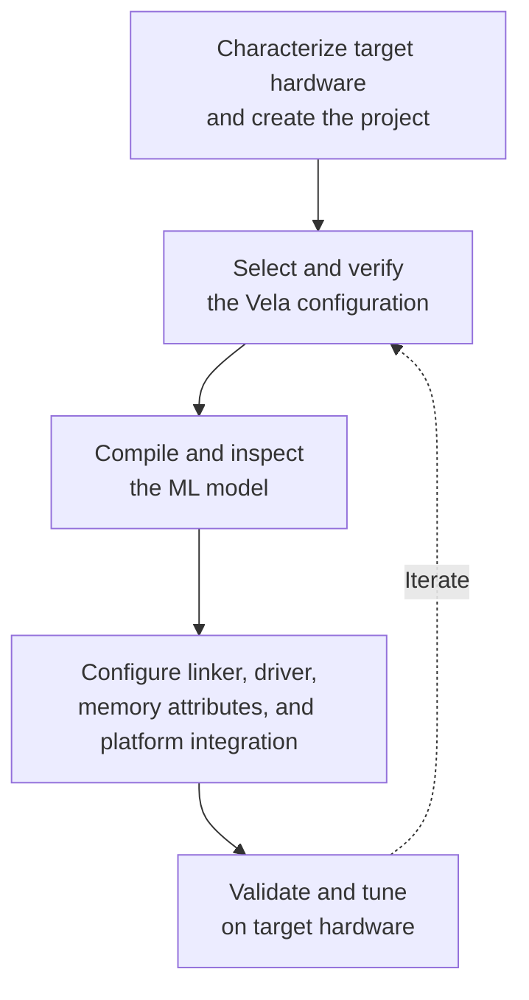

The diagram summarizes the integration workflow and its iteration loop. Follow
the detailed steps in order because later steps depend on earlier decisions and
measurements.

1. **Characterize the target hardware and create the project.**
   Identify the NPU configuration, NPU-accessible memories, access constraints,
   and device resources before choosing a software configuration.
2. **Select and verify the Vela configuration.**
   Confirm that the device-specific system configuration and memory mode model
   the intended physical memories and match the NPU variant and MAC count.
3. **Compile and inspect the ML model.**
   Run Vela with the verified settings and check its operator placement, memory
   use, and performance estimates against the application requirements.
4. **Configure the platform integration.**
   Keep the linker placement, driver regions, MPU/SAU attributes, cache policy,
   address mapping, and runtime integration consistent with the Vela configuration.
5. **Validate and tune.** Verify
   correctness, memory use, and performance on the target hardware.

For the supported Corstone FVP configurations and their corresponding Vela,
driver, and linker settings, see
fvp-ethos-setup "Configure Ethos-U for FVP Simulation Models".

### Configuration consistency checklist

An Ethos-U application describes the same memory system in several places.
Vela uses a performance model and logical memory areas when it creates the
command stream, while the linker, driver, and platform configuration implement
those choices on physical hardware. A mismatch can produce inaccurate Vela
estimates, inaccessible data, cache-coherency failures, or an inference that
does not complete. Use this checklist whenever selecting a target, changing a
memory mode, or replacing the ML model.

| Check | Configuration source | Why and what to verify |
|---|---|---|
| Target hardware | Device documentation and DFP | Establish the NPU variant and MAC count, NPU-accessible memories and capacities, read/write restrictions, security attribution, and CPU cacheability before selecting compiler settings. |
| Vela system and memory configuration | `System_Config` and `Memory_Mode` in the device-specific `vela.ini` | Confirm that the logical areas model the intended physical memories and their performance, and that constants, the writable arena, and optional fast scratch are assigned to suitable access paths. |
| Model compilation | Generated `*.cbuild-mlops.yml` and Vela invocation | Confirm the accelerator, MAC count, `vela.ini`, system configuration, memory mode, and model input before treating the generated model as target-compatible. |
| Vela report | Vela summary and CSV reports | Check that allocations fit the available memories, the expected operators run on the NPU, and estimated bandwidth and performance are suitable for the application. |
| Linker placement | Linker script and link map | Confirm that the compiled model, tensor arena, and optional fast-scratch buffer occupy the physical memories modeled by Vela, with sufficient size and alignment. |
| Driver memory access | `NPU_QCONFIG` and `NPU_REGIONCFG_x` | Ensure that command-stream and base-region accesses use the NPU paths and attributes that reach the linked physical memories. |
| Platform memory attributes | MPU/SAU, cache policy, and address mapping | Ensure that the CPU and NPU have compatible security and access permissions, and provide address translation and cache maintenance where required. |
| Target validation | Link map, functional tests, driver diagnostics, and PMU measurements | Verify correct results and stable execution, then compare actual memory use and performance with the compiler estimates. |

> [!IMPORTANT]
>
> The Vela configuration, linker placement, driver memory-access selectors, and
> MPU/SAU and cache attributes must all describe the same physical-memory
> arrangement.
