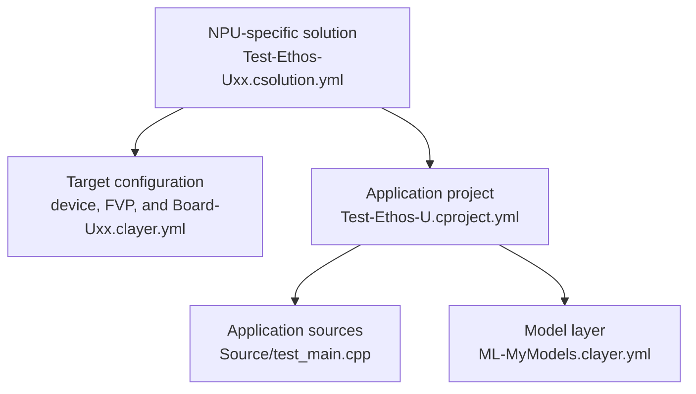

_Part of: Tutorial: Create an Ethos-U application_

This tutorial applies the five-step workflow to the `Test-Ethos-U` examples in
the `ARM::CMSIS-Ethos-U` pack. The three examples have the same application
structure and uses the same ML models. Each example targets a different Ethos-U
variant.

In Keil Studio, use **Create a New Solution** as described in
[Work with CMSIS solutions](https://mdk-packs.github.io/vscode-cmsis-solution-docs/create_app.html).
From the table, select the target board and corresponding example that matches
the Ethos-U variant in the target hardware. After creating the example, you can
compile it and run it directly on the FVP simulation with the
[action buttons](https://github.com/Open-CMSIS-Pack/vscode-cmsis-solution#action-buttons)
in the
[CMSIS view](https://mdk-packs.github.io/vscode-cmsis-solution-docs/userinterface.html#2-main-area-of-the-cmsis-view).
Keil Studio automatically downloads and installs the required tools and
software packs. The initial setup may take some time.

Target board                 | Example                        | NPU/MACs      | FVP simulation model
:----------------------------|:-------------------------------|:--------------|:-------------------
V2M-MPS3-SSE-300-FVP         | `Test-Ethos-U55.csolution.yml` | Ethos-U55-128 | Corstone-300
V2M-MPS3-SSE-300-FVP         | `Test-Ethos-U65.csolution.yml` | Ethos-U65-256 | Corstone-300
SSE-320                      | `Test-Ethos-U85.csolution.yml` | Ethos-U85-256 | Corstone-320

For a complete implementation on physical hardware, see
[CMSIS-Ethos-Integration](https://github.com/Arm-Examples/CMSIS-Ethos-Integration).
It applies this integration workflow to a real-world device.

Each example includes the `Test-Ethos-U.cproject.yml` file and the
software layers shown in this diagram:



The model layer supplies two quantized TensorFlow Lite (`int8`) models:
`hello_world`, a dense network that approximates `sin(x)`, and `tiny_cnn`, an
image classifier that exercises convolution and pooling operations. The
application runs one test input through each model on the selected NPU and
checks both results against embedded reference output.

When both model checks pass, the FVP simulation model outputs:

```text
2 of 2 checks passed
TEST RESULT: PASS
```

This confirms that the example and tool setup work correctly.

Use the supplied layer as a known-good baseline to verify the system integration
and tool setup. Once verified, replace it with a layer containing the
application-specific ML model.

> [!NOTE]
>
> - The committed ML model artifacts are precompiled for Ethos-U55-128. Follow
>   Step 2 to compile them for the NPU configuration of the selected target.
> - The Corstone examples can also test Ethos-U65 and Ethos-U85 targets with the
>   corresponding FVP models. Keep the accelerator and MAC configuration
>   consistent in the solution MLOps information, Board layer, Vela command, and
>   FVP configuration.
