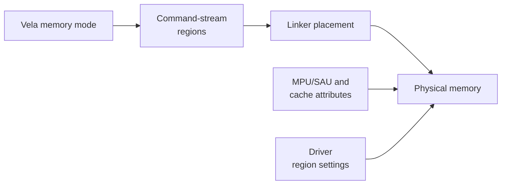

_Part of: Tutorial: Create an Ethos-U application_

Keep the Vela memory mode, linker placement, and driver regions consistent,
then build the system and confirm the allocations in the linker map. The diagram
summarizes the required settings.

#### Linker placement

The examples place compiled model constants in the `ethos_model` section, the
tensor arena in `ethos_arena`, and an optional cache buffer in `ethos_cache`.
Map these sections to the physical memories selected by the Vela memory mode.
Preserve their alignment requirements and use the linker map to confirm their
addresses and sizes. See
Create the linker script
for the detailed mapping between Vela memory areas and linker sections.

#### MPU/SAU and cache attributes

Configure each memory region so that the CPU and NPU have the required security
and access permissions. If a CPU mapping is cacheable and is not coherent with
the NPU, provide the required cache clean and invalidate operations.

#### Driver region settings

Set `NPU_REGIONCFG_0`, `NPU_REGIONCFG_1`, and `NPU_REGIONCFG_2` as defines in
the related `<board>.clayer.yml` file so that the driver access paths match
`const_mem_area`, `arena_mem_area`, and `cache_mem_area`. See
Match the driver configuration
for the mapping.

#### Complete application integration

Review the driver's weak callbacks described in
Platform-specific functions
and override those required by the target. These callbacks provide cache
maintenance, CPU-to-NPU address remapping, run-time region selection, RTOS
synchronization, and begin/end inference hooks for power control or tracing.

Follow the related guidance for data caching,
mutexes and semaphores, and
begin/end inference callbacks.
Configure a finite inference timeout where appropriate, report NPU faults, and
complete the driver bring-up checklist
before relying on the integration in an application.
