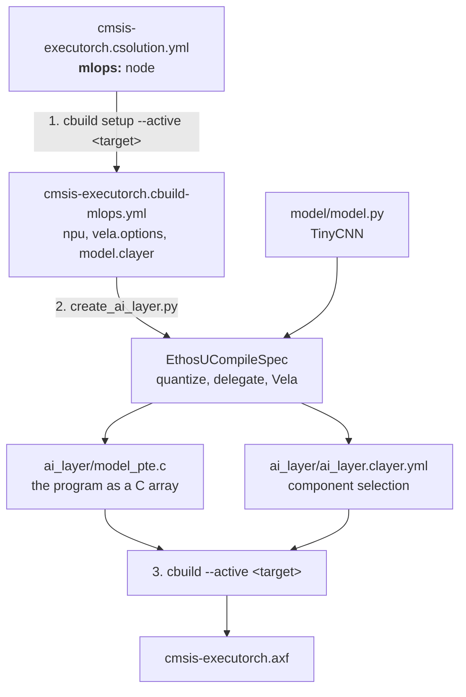

The `mlops:` node in `cmsis-executorch.csolution.yml` is the central
definition of the initial Ethos-U target for this template. It follows the CMSIS-Toolbox
[MLOps information](https://open-cmsis-pack.github.io/cmsis-toolbox/build-overview/#mlops-information)
specification. This document explains how the three build steps use and
propagate that information.

