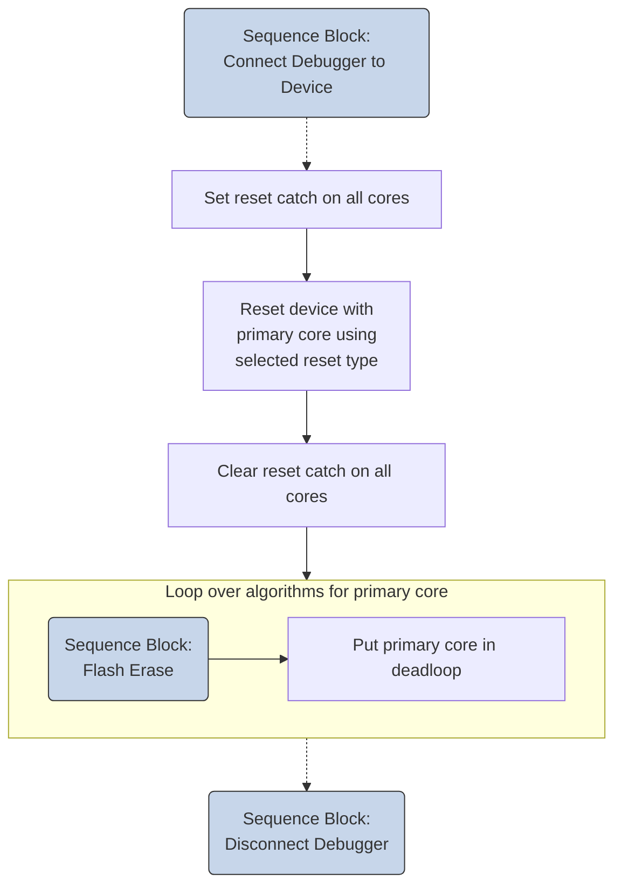
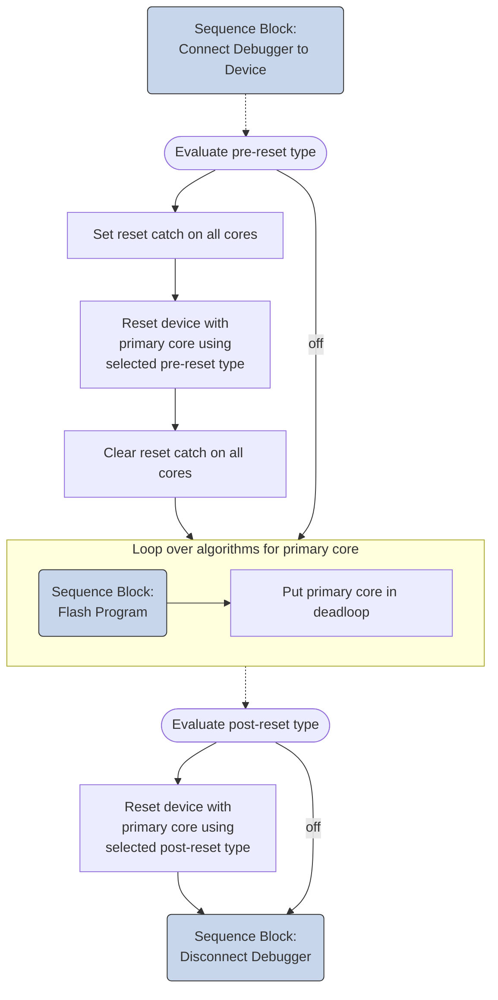
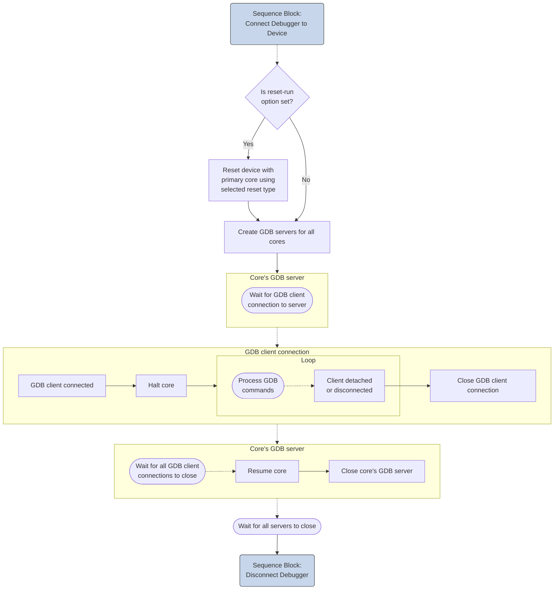
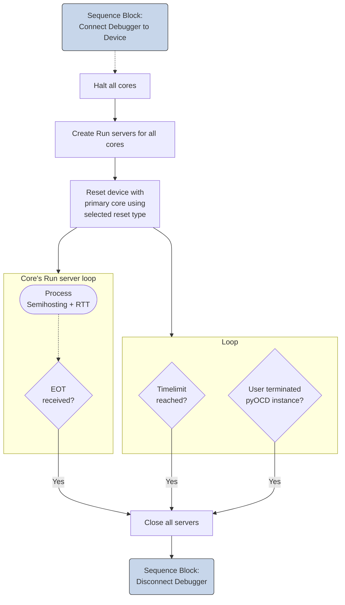

The sequence diagrams below show the usage of the debug access sequences for pyOCD commands. The specification [Open-CMSIS-Pack: Usage of debug access sequences](https://open-cmsis-pack.github.io/Open-CMSIS-Pack-Spec/main/html/debug_description.html#usage_of_sequences) describes the following sequence blocks. pyOCD uses these concepts, but implements these deviations:

- **Connect Debugger to Device**:  
    - For the [`connect:`](#connect) mode `attach`, no reset or halt operations are issued.
    - For multi-processor systems, only the following blocks are executed once per processor core: **Read Target Features**, **DebugCoreStart**, **Stop Processor** / **ResetCatchSet**,
    **Wait for Processor to Stop**, and **Initialize Debug Components**. The remaining diagram elements run once for the device as a whole. This distinction is important for multi-core targets, where some blocks run once per core and others run once for the device.

!!! Info
    Sequence Blocks in the diagrams below link to the [Open-CMSIS-Pack](https://open-cmsis-pack.github.io/Open-CMSIS-Pack-Spec/main/html/debug_description.html#usage_of_sequences) specification that provides further details.

---

### Command: pyOCD erase

---

### Command: pyOCD load

---

### Command: pyOCD gdbserver

---

### Command: pyOCD run

