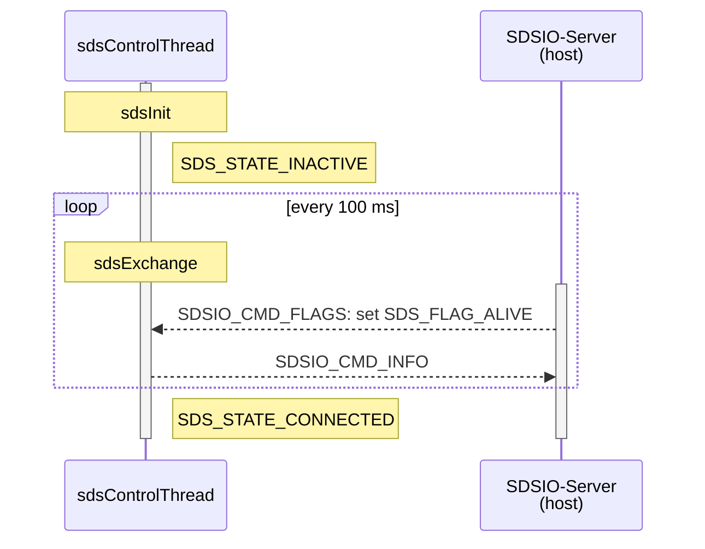
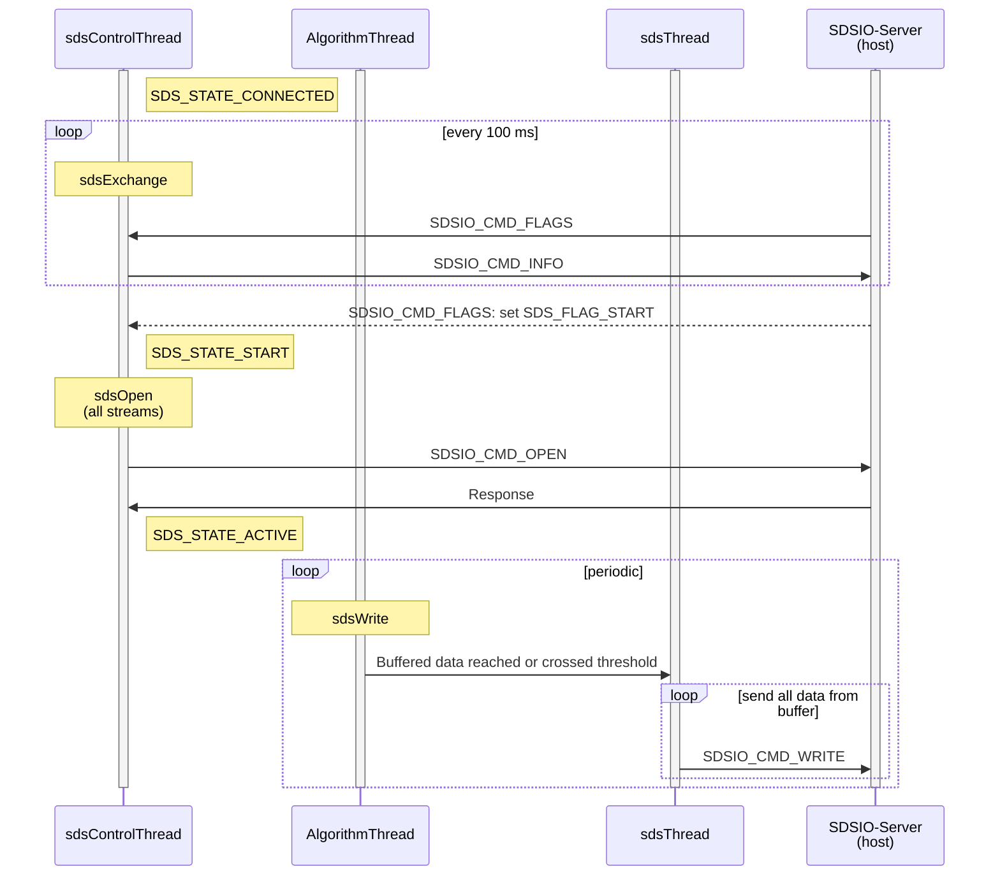
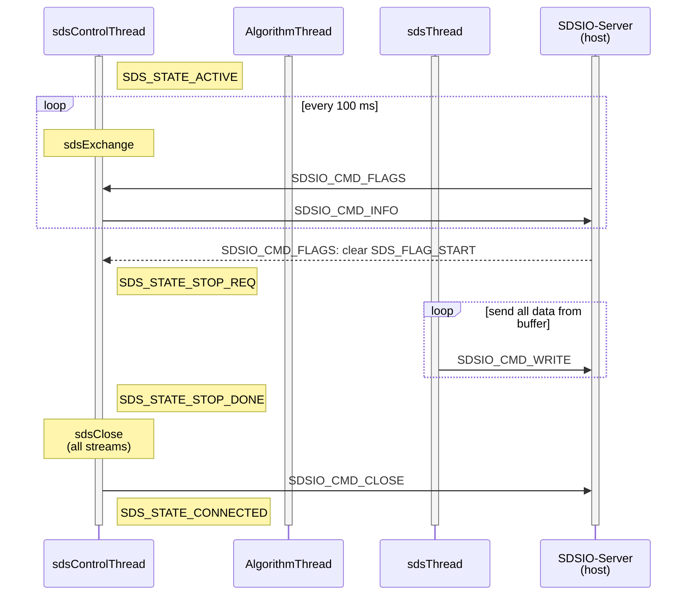
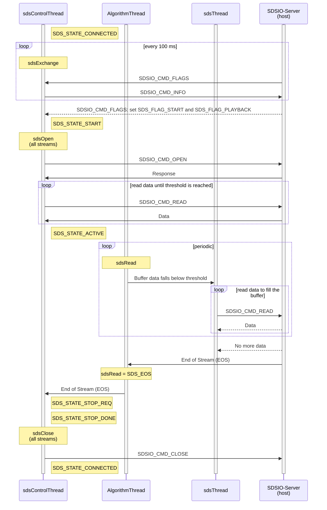

This section describes the states and the message sequence of the SDS framework when using the [SDSIO-Server](https://github.com/ARM-software/SDS-Framework/blob/4459441/documentation/utilities.md#sdsio-server).
It contains the following threads that execute on the target.

- **sdsControlThread**: Control thread that organizes the overall execution.
- **AlgorithmThread**: Executes the algorithm under test.
- **sdsThread**: SDS worker thread.
- **SDSIO-Server**: SDSIO-Server running on the host computer.

!!! Note
    - The command `SDSIO_CMD_FLAGS` is sent asynchronously by the SDSIO-Server.

The `sdsControlThread` handles a state machine with the following states:

States                   | Description
:------------------------|:------------
SDS_STATE_INACTIVE       | Streaming is not active; waiting for flag info from SDSIO-Server
SDS_STATE_CONNECTED      | Device (client) is connected to SDSIO-Server (host), but streaming is not active
SDS_STATE_START          | Request to start streaming, open streams and get ready for read/write operations
SDS_STATE_ACTIVE         | Streaming is active
SDS_STATE_STOP_REQ       | Request to stop streaming and close open streams
SDS_STATE_STOP_DONE      | Streaming has stopped
SDS_STATE_END            | Request to end streaming (e.g., no more playback data is available)
SDS_STATE_RESET          | Request to reset the device

The following flowcharts show the state transition in context with the messages that are exchanged with the `SDSIO-Server`.

**Connect flowchart**

!!! Note
    - When the command `SDSIO_CMD_FLAGS` sets SDS_FLAG_ALIVE, the `sdsControlThread` transitions to SDS_STATE_CONNECTED.
    - When `SDSIO_CMD_INFO` is sent more than 10 times without a `SDSIO_CMD_FLAGS` response, the `sdsControlThread` transitions into the SDS_STATE_INACTIVE.

**Recording start flowchart**

**Recording stop flowchart**

**Playback flowchart**

