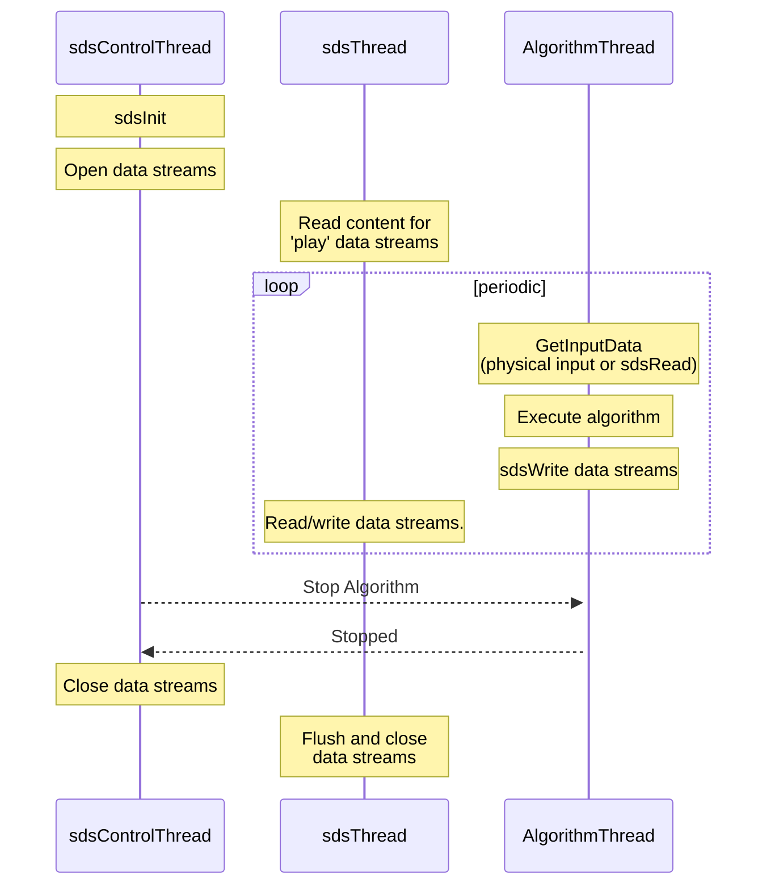

The following diagram shows the usage of the SDS Stream Interface functions (executed in `sdsThread`).  The `sdsControlThread` controls the overall execution. `AlgorithmThread` is the thread that executes Signal Conditioning (SC) and the ML Model.

When `AlgorithmThread` starts, it first calls the `InitInputData` function, which initializes the input interfaces
(camera, microphone or sensor interfaces). It then calls `InitAlgorithm`, which is responsible for initializing the ML algorithm.

After initialization, `AlgorithmThread` enters a loop in which it repeatedly calls `GetInputData`. This function provides a block of input data
used for a single inference. The inference itself is executed by the `ExecuteAlgorithm` function.

Two additional functions are also provided:

- `DiscardInputData`: used during playback to discard incoming live input data, since the actual input is read from the SDS file.
- `ResetAlgorithm`: called before each playback run to reset internal states, memory buffers, and results from previous inferences,
  ensuring a clean start for the new playback session.

